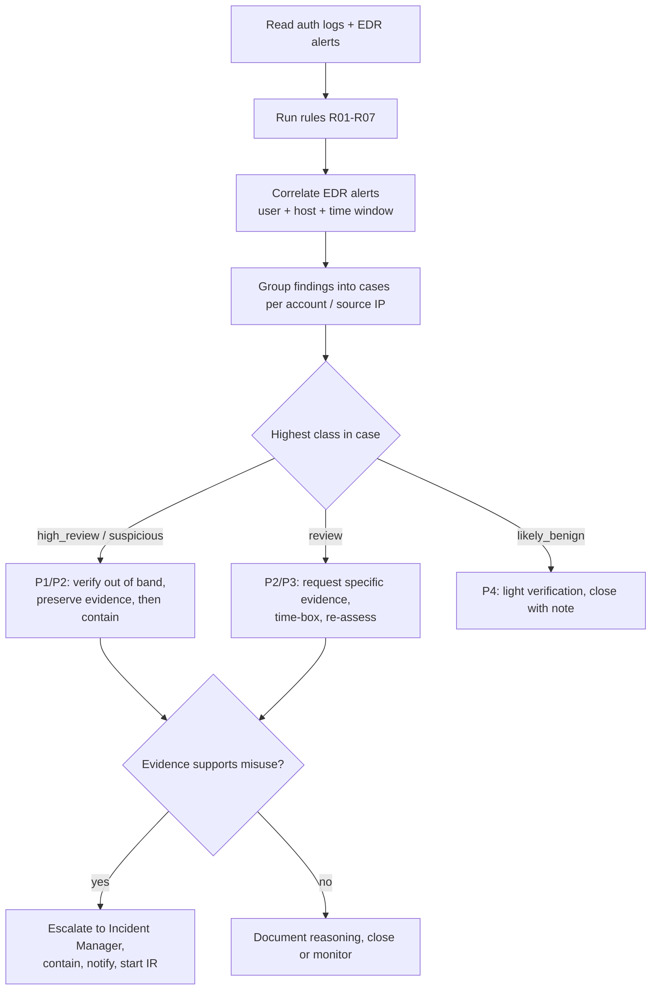

# Incident Triage Workflow

| # | Analyst step | Tool support |
|---|---|---|
| 1 | Build a timeline from timestamps and IDs | `incident_timeline.csv`, report section 3 |
| 2 | Sort events into benign / suspicious / needs evidence | Rule classes |
| 3 | Correlate sources before concluding | `edr_correlation.py`, timing-discrepancy notes |
| 4 | State confidence and what would change it | Confidence field, "Evidence to request" |
| 5 | Preserve evidence first | Playbook order, "Response principles" |
| 6 | Contain with reversible controls | Playbook per rule |
| 7 | Communicate need-to-know, neutral wording | Communication bullets |
| 8 | Do not claim compromise without evidence | Report wording and a test |

## Priorities
P1 = high severity (possible access or unapproved privilege): start now, verify with the owner within the hour.
P2 = medium: same shift. P3 = low and uncorroborated: next business day. P4 = likely benign: close with a note.
(Suggested defaults for this prototype, not an organisation's SLA.)

Escalate to the Incident Manager when a user denies a login, a privilege change has no approval, an account shows
activity after a suspicious login, or the same indicator appears across several accounts.

## Containment order (evidence-preserving)
1. Capture: export and hash logs, session and token metadata, EDR timeline, admin audit record.
2. Verify with the owner on a known channel.
3. Reversible limits: rate limit or temporary source block, step-up authentication, restricted access.
4. Only then: terminate sessions, revoke tokens, reset credentials, remove unapproved privileges.
5. Record every action in the ticket.
